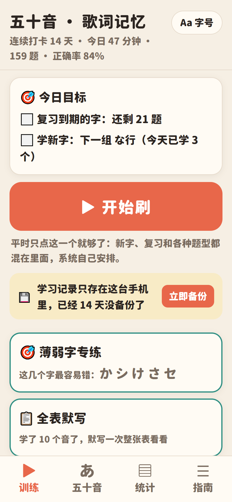
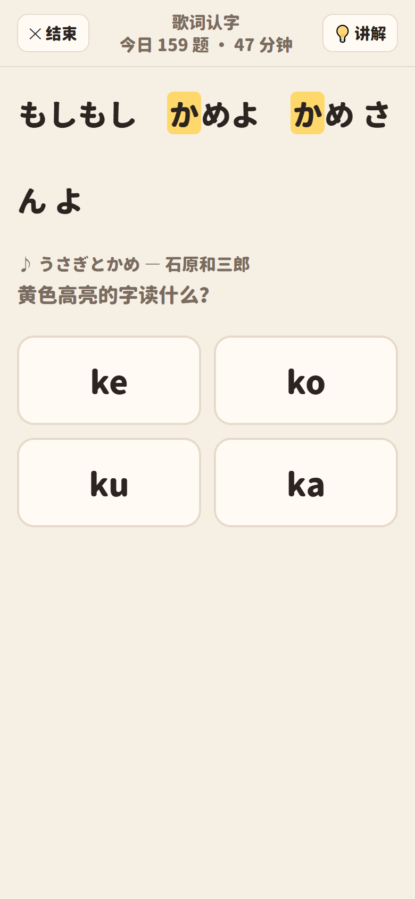
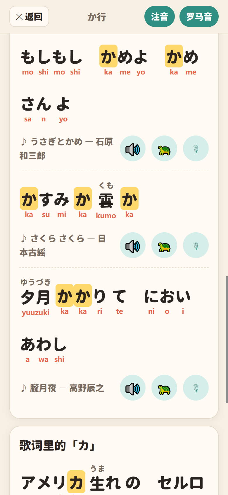
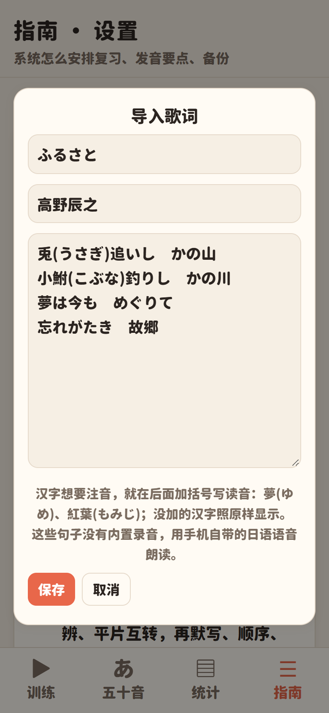
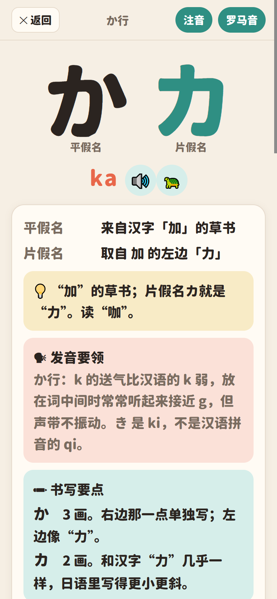
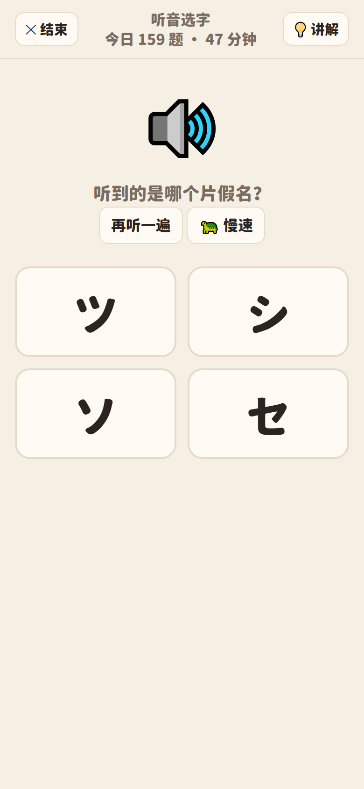
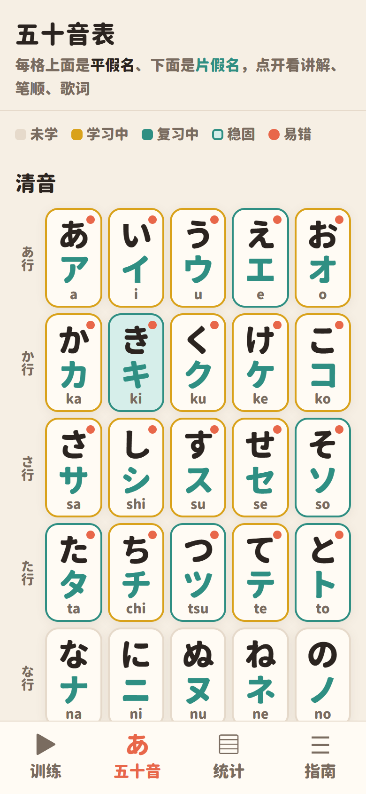
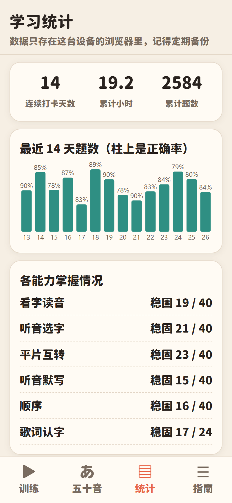

# 五十音 · 歌词记忆（kana-lyrics）

**用你喜欢的歌的歌词记住平假名和片假名。** 每个假名都配上歌词里的真实例句，句子上方有汉字注音，每个假名下方有罗马音，播放时逐字高亮。平时只点一个「开始刷」：学新字、巩固、复习、加练全部由系统安排，用的是 FSRS 记忆模型，在你快要忘的时候再考。

安卓 App，离线就能用。

*Learn Japanese kana (hiragana + katakana together) through lines from songs you love. Offline Android app with an FSRS spaced-repetition scheduler, Chinese UI.*

<table>
<tr>
<td></td>
<td></td>
<td></td>
<td></td>
</tr>
<tr>
<td align="center">今日目标，一键开始刷</td>
<td align="center">歌词认字题</td>
<td align="center">歌词例句：注音 + 罗马音 + 逐字高亮</td>
<td align="center">导入你自己的歌词</td>
</tr>
<tr>
<td></td>
<td></td>
<td></td>
<td></td>
</tr>
<tr>
<td align="center">讲解：字源、口诀、发音要领</td>
<td align="center">听音选字（易混字做干扰项）</td>
<td align="center">五十音表：掌握程度一目了然</td>
<td align="center">学习统计</td>
</tr>
</table>

<sub>截图来自早期版本，3.0 的界面基本一样。</sub>

## 下载

[**Releases**](../../releases) 里下载最新的 `kana-lyrics-*.apk`（Android 7.0 及以上），或者直接用 [`dist/kana-lyrics.apk`](dist/kana-lyrics.apk)。下载后直接安装，配音、真人录音、字体都已经打包在里面。

从 3.0 开始只做安卓 App，不再提供单文件网页版。

## 功能

- **只管点「开始刷」**：新字、巩固、复习和各种题型混在一起，系统自己安排。首页写着今天推荐的量；超过推荐只提醒一次，想继续就继续。
- **FSRS 记忆模型**：每个字记录“能记几天”和“对你难不难”，在快要忘的时候再考（目标记忆率默认 90%，也可以自动调整）。新字 1 分钟、6 分钟、20 分钟各考一次，第二天必考。答错不清零，只缩短间隔。答满约 1000 题后，每周用你自己的答题记录重新拟合模型参数。
- **四档判分，快慢只和自己比**：忘了 / 吃力 / 记得 / 很熟，由对错和反应时间自动判断。速度只和你自己在这种题上的平时速度比，蓝牙耳机延迟会被抵消。答得对但总要想半天的字标成“记得但慢”，多出快速判断题。
- **平假名、片假名一起学会**：同一个音的平假名答错，片假名几分钟后马上抽查（反过来也一样）。片假名落后时多出片假名题、暂停新字，直到两边追平；统计页有两条对比曲线。
- **错了马上加练**：选错易混字（シ / ツ），过两三题再考这两个；认得但慢的字攒够 3 个，来一组提速题；每 20 题一句小结。
- **状态自适应**：最近 10 题正确率很高，新内容来得快一点；错得多，就先只复习、不加新字。
- **开局定级**：第一次打开可以做 2～3 分钟测验，每行抽两个字（平、片都有），又对又快的行直接标“熟练”。
- **歌词辅助记忆**：每个假名配最多 3 句歌词例句，汉字上方标注音，每个假名正下方标罗马音。播放时卡拉 OK 式逐字高亮，还能🐢慢速播放、🎙跟读对比。
- **导入自己的歌**：在「指南 → 我的歌词」里粘贴任意日语歌词，程序自动给每个假名挑出合适的句子，放进讲解页和“歌词认字”题里（详见下文）。
- **题型自由搭配**：默认开最实用的几种（看字选发音、听音选字、⚡快速判断、🧩拼词、🎵歌词填空、听辨对比）；平片互转、🔍找字、听一串点出来、全表点字、✍听音默写等可以自己打开，每种设 关 / 少 / 正常 / 多，还能先试 5 题。另外有 60 秒冲刺、乱序闪认、顺背倒背、片假名专练、薄弱字专练、全表默写。
- **讲解页**：字源（来自哪个汉字）、原创口诀和图像记忆卡、发音要领（中国人容易读错的音）、易混字对比、笔顺动画、常用词（标“真人”的是真人录音）。
- **五十音表手动标记**：熟练 / 不熟练 / 未学 / 恢复自动，可以标一个字、一整行或一整段。
- **记录和提醒**：学习记录存在 App 自己的存储里，每题写进答题日志；每周自动备份到手机「下载/五十音」（保留最近 4 份）。每日练习提醒、睡前复习提醒，以及攒够约 30 题到期时的提醒（只在 8:00–22:30）。
- **其他**：大字号（四档可调）、深色模式、学习统计（未来 7 天复习量预测、实际记住的比例、最常搞混的字、各题型速度）、导出 / 导入备份。
- **体积小**：全部录音是 Opus 格式，整个 App 不到 3 MB。

## 导入自己的歌词

1. 打开「指南」页，找到 **🎵 我的歌词**，点 **＋ 导入歌词**。
2. 填上歌名、歌手，把日语歌词粘贴进去，一行一句。
3. 汉字要注音，就在后面加括号写读音，比如 `夢(ゆめ)`、`紅葉(もみじ)`。没写读音的汉字照原样显示。
4. 保存后，含有对应假名的句子会自动出现在讲解页和练习题里。

导入的歌词只保存在你自己的手机上，不会上传到任何地方。这些句子没有内置录音，用手机自带的日语语音朗读。如果没声音，请在系统设置里安装日语的“文字转语音”语音包。

## 用自己的歌单生成完整版（电脑）

想让自己的歌也有注音自动标注、VOICEVOX 配音和逐字高亮，可以在电脑上生成一份自己的版本：

需要：[Node.js](https://nodejs.org/) 18+、[ffmpeg](https://ffmpeg.org/)（把录音转成 Opus；不在 PATH 里就用环境变量 `FFMPEG` 指定）、[VOICEVOX](https://voicevox.hiroshiba.jp/) 引擎（运行在 `127.0.0.1:50021`），以及任意一款中日文字体（本项目用的是资源圆体 Heavy）。

1. 准备歌词文本，格式同 [`web/lyrics-public.txt`](web/lyrics-public.txt)：每首歌以 `【序号】歌名 - 歌手` 开头，下面一行一句。读音特殊的汉字可以写成 `漢字(よみ)`。
2. 依次运行：

```bash
cd web
npm install
node pick.js 我的歌词.txt data.json      # 给每个假名挑例句；kuromoji 标注音，VOICEVOX 核对读音
node tts.js 8                             # 生成配音（8 = 春日部つむぎ），需要开着 VOICEVOX
node timings.js 8                         # 生成逐字高亮的时间轴
node build.js 字体.ttf ../app             # 生成 App 文件夹：index.html + audio/（字体裁剪后嵌入）
node serve.js ../app                      # 可选：在电脑浏览器里预览 http://localhost:5178/index.html
```

3. 打包成 APK：给 [`android/`](android/) 配好 JDK 17、Android SDK（build-tools 34.0.0、platforms/android-34）和 7-Zip，然后运行：

```bash
node android/build-apk.js app/index.html 我的版本.apk app
```

不需要 Gradle。工具路径用环境变量 `JDK_BIN`、`ANDROID_SDK`、`SEVENZ` 指定，签名密码用 `KANA_KS_PASS`（第一次运行会自动生成签名文件）。录音和图片用 7-Zip 放进 APK，因为 Windows 上的 aapt2 会把子文件夹路径写成反斜杠，安卓读不到。

> ⚠️ 歌词受版权保护。用自己歌单生成的版本请只给自己用，不要把含有受版权保护歌词的成品公开分享。本仓库里的示例歌词全部是已进入公有领域的日本童谣和唱歌（如「故郷」「赤とんぼ」「荒城の月」，均于 1929 年前发表，作词者去世已超过 50 年，或为作者不详的文部省唱歌）。

## 目录结构

```
dist/        打包好的 APK
web/         源码和生成脚本
  template.html      程序本体：知识表、FSRS 调度、题型、界面
  build.js           注入数据和字体，把录音转成 Opus，生成 App 文件夹（加 public 参数生成公开版）
  pick.js            用 kuromoji 分词标注音，给每个假名挑例句
  tts.js / timings.js  VOICEVOX 配音和逐字时间轴
  ka-map.js / fuku-get.js  整理真人录音（Kanji alive / Lingua Libre）
  serve.js           电脑上预览用的小服务器
  shots.js           用无头浏览器截 README 截图
android/     安卓 WebView 外壳（记录存储、答题日志、自动备份、提醒）和免 Gradle 打包脚本
screenshots/ 截图
```

## 素材与许可 / Credits & licenses

- 代码和原创教学内容（讲解、口诀、图像记忆卡）：[MIT](LICENSE)
- 合成语音：**VOICEVOX:春日部つむぎ**（[VOICEVOX](https://voicevox.hiroshiba.jp/)，按角色使用条款署名）
- 真人单词 / 假名录音：[Kanji alive](https://kanjialive.com)（CC BY 4.0）；Fukujinzuke 的录音来自 [Lingua Libre](https://lingualibre.org) / Wikimedia Commons（CC BY 4.0，去掉首尾静音）。打包时统一转成 Opus 格式。
- 笔顺数据：[KanjiVG](https://kanjivg.tagaini.net)（© Ulrich Apel，CC BY-SA 3.0）。`web/strokes.json` 按 CC BY-SA 3.0 授权。
- 字体：资源圆体 Resource Han Rounded（© Cyano Hao，基于 Adobe 思源黑体，[SIL Open Font License 1.1](https://scripts.sil.org/OFL)），裁剪子集后嵌入
- 记忆模型：[FSRS](https://github.com/open-spaced-repetition/fsrs4anki)（FSRS-5 公式和默认参数）
- 构建时用到：[kuromoji.js](https://github.com/takuyaa/kuromoji.js)（Apache-2.0）、[lamejs](https://github.com/zhuker/lamejs)（LGPL-3.0）、[subset-font](https://github.com/papandreou/subset-font)（BSD-3-Clause）、[ffmpeg](https://ffmpeg.org/)（Opus 转码）
- 示例歌词：公有领域的日本童谣、唱歌（见 [`web/lyrics-public.txt`](web/lyrics-public.txt)）
