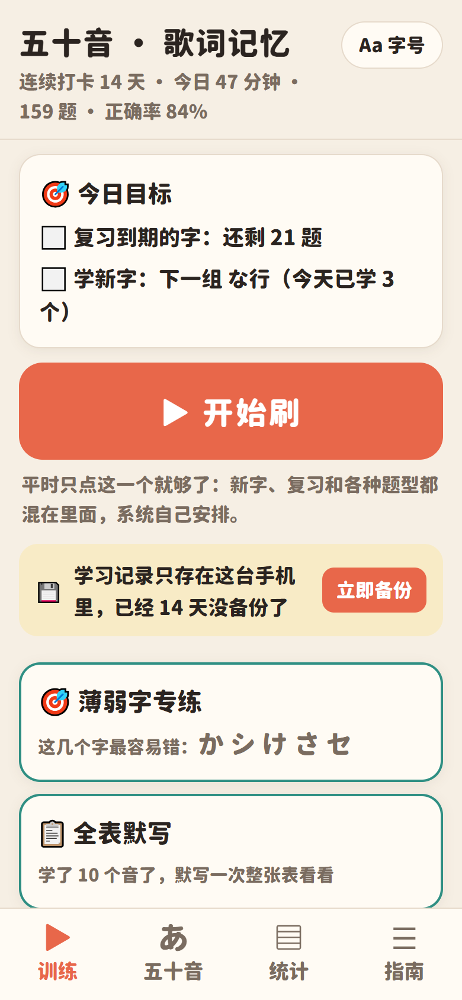
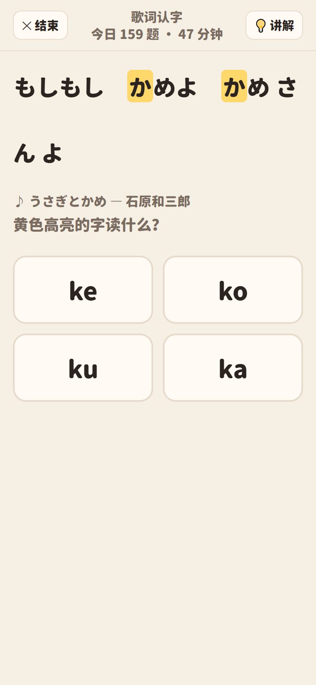
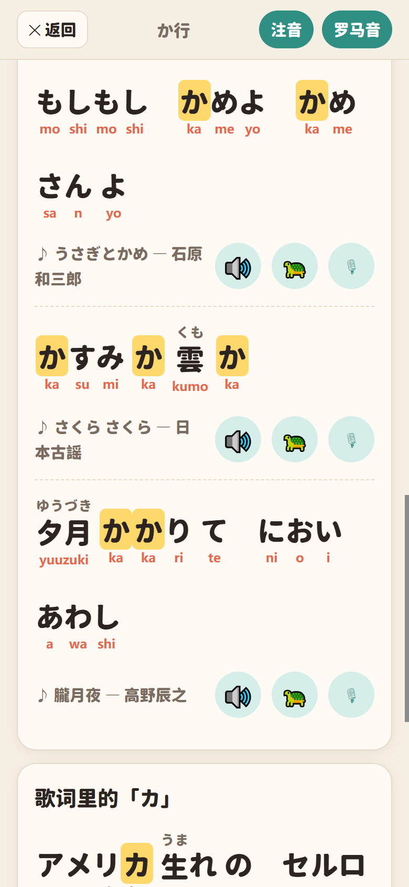
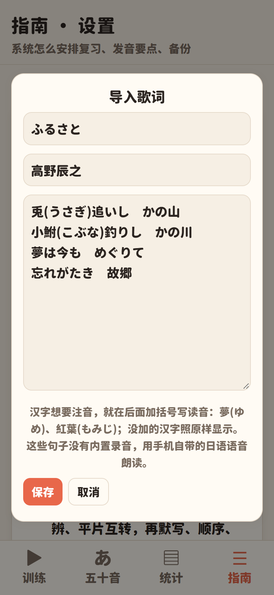
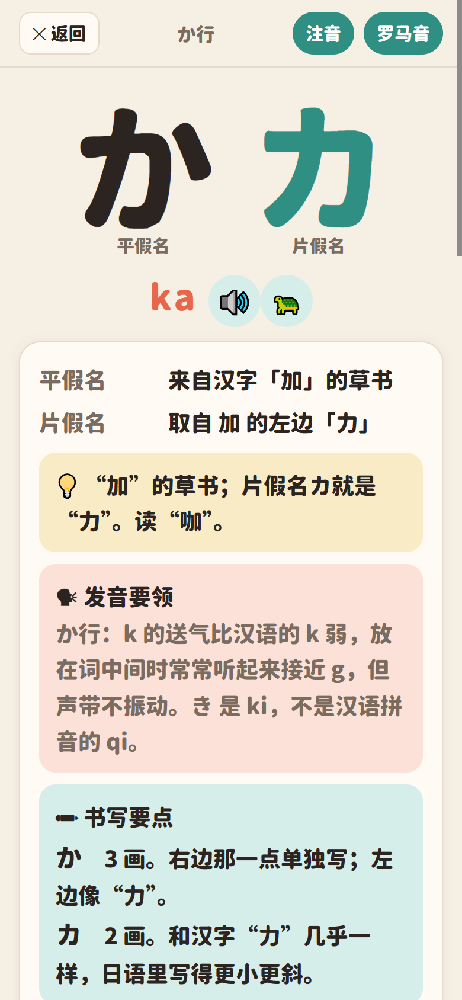
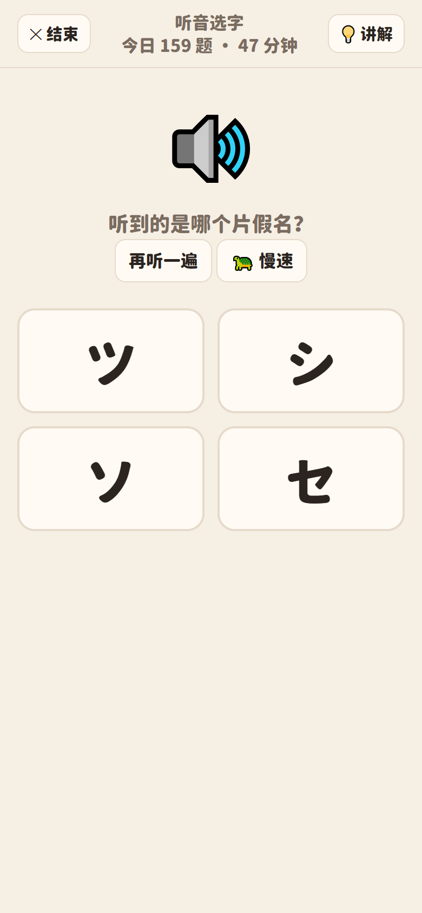
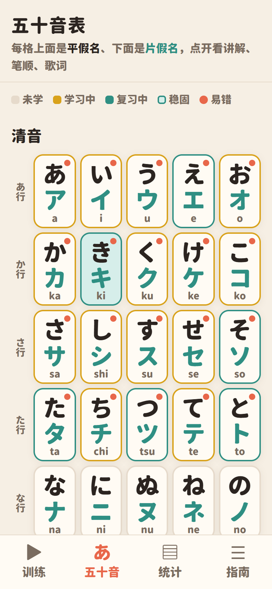
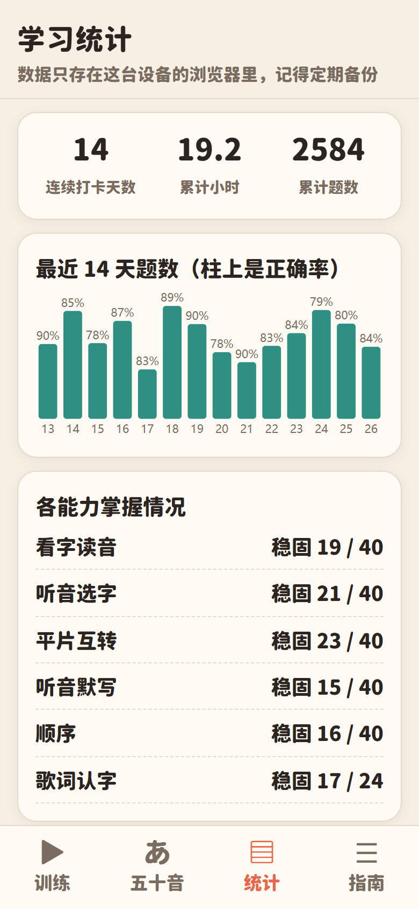

# 五十音 · 歌词记忆（kana-lyrics）

**用你喜欢的歌的歌词记住平假名和片假名。** 每个假名都配上歌词里的真实例句，句子上方有汉字注音，每个假名下方有罗马音，播放时逐字高亮。训练由系统安排：新字、复习、各种题型混在一起刷，记不牢的字自动多练。

安卓 App，也是一个单文件网页，离线就能用。

*Learn Japanese kana (hiragana + katakana together) through lines from songs you love. Android app / single offline HTML page, Chinese UI.*

<table>
<tr>
<td></td>
<td></td>
<td></td>
<td></td>
</tr>
<tr>
<td align="center">今日目标，一键开始刷</td>
<td align="center">歌词认字题</td>
<td align="center">歌词例句：注音 + 罗马音 + 逐字高亮</td>
<td align="center">导入你自己的歌词</td>
</tr>
<tr>
<td></td>
<td></td>
<td></td>
<td></td>
</tr>
<tr>
<td align="center">讲解：字源、口诀、发音要领</td>
<td align="center">听音选字（易混字做干扰项）</td>
<td align="center">五十音表：掌握程度一目了然</td>
<td align="center">学习统计</td>
</tr>
</table>

## 下载

| 文件 | 说明 |
|---|---|
| [`dist/kana-lyrics.apk`](dist/kana-lyrics.apk) | 安卓 App（Android 7.0 及以上），下载后直接安装 |
| [`dist/kana-lyrics.html`](dist/kana-lyrics.html) | 同一个程序的网页版，下载后用手机或电脑的浏览器打开 |

两个都是完整离线版，配音、真人录音、字体都已经打包在里面。

## 功能

- **平假名、片假名一起学**：あ和ア同时出现、互相转换。片假名容易落后，系统会额外加练。
- **歌词辅助记忆**：每个假名配最多 3 句歌词例句，汉字上方标注音，每个假名正下方标罗马音。播放时卡拉 OK 式逐字高亮，还能🐢慢速播放、🎙跟读对比。
- **导入自己的歌**：在「指南 → 我的歌词」里粘贴任意日语歌词。程序自动给每个假名挑出合适的句子，放进讲解页和“歌词认字”题里（详见下文）。
- **科学刷题**：间隔重复（1 分钟 → 10 分钟 → 30 分钟 → 1、2、4、8、16 天），新字按行引入，各种题型混在一起出。连续 30 分钟会提醒休息。
- **11 种题型**：看字读音、听音选字、平片互转、听音默写（手写板）、顺序（上下左右邻居）、歌词认字、整句朗读、读词、读片假名词、听辨对比（如 おばさん / おばあさん）、全表点字。另外有 60 秒冲刺、闪卡、顺背倒背整行、薄弱字专练、全表默写。
- **讲解页**：字源（来自哪个汉字）、原创口诀和图像记忆卡、发音要领（中国人容易读错的音）、易混字对比、笔顺动画、手写描红，还有常用词（标“真人”的是真人录音）。
- **发音**：46 个清音全部是真人录音，一部分浊音和 200 多个常用词也是（Kanji alive、Lingua Libre），其余用 VOICEVOX 合成。
- **其他**：大字号（四档可调）、深色模式、每日提醒（App）、学习统计、导出 / 导入备份。

## 导入自己的歌词

1. 打开「指南」页，滑到底部的 **🎵 我的歌词**，点 **＋ 导入歌词**。
2. 填上歌名、歌手，把日语歌词粘贴进去，一行一句。
3. 汉字要注音，就在后面加括号写读音，比如 `夢(ゆめ)`、`紅葉(もみじ)`。没写读音的汉字照原样显示。
4. 保存后，含有对应假名的句子会自动出现在讲解页和练习题里。

导入的歌词只保存在你自己的手机上，不会上传到任何地方。这些句子没有内置录音，用手机自带的日语语音朗读。如果没声音，请在系统设置里安装日语的“文字转语音”语音包。

## 用自己的歌单生成完整版（电脑）

想让自己的歌也有注音自动标注、VOICEVOX 配音和逐字高亮，可以在电脑上生成一份自己的版本：

需要：[Node.js](https://nodejs.org/) 18+、[VOICEVOX](https://voicevox.hiroshiba.jp/) 引擎（运行在 `127.0.0.1:50021`），以及任意一款中日文字体（本项目用的是资源圆体 Heavy）。

1. 准备歌词文本，格式同 [`web/lyrics-public.txt`](web/lyrics-public.txt)：每首歌以 `【序号】歌名 - 歌手` 开头，下面一行一句。读音特殊的汉字可以写成 `漢字(よみ)`。
2. 依次运行：

```bash
cd web
npm install
node pick.js 我的歌词.txt data.json      # 给每个假名挑例句；kuromoji 标注音，VOICEVOX 核对读音
node tts.js 8                             # 生成配音（8 = 春日部つむぎ），需要开着 VOICEVOX
node timings.js 8                         # 生成逐字高亮的时间轴
node build.js 字体.ttf 我的版本.html       # 生成单文件网页（字体会被裁剪后嵌入）
```

3. 打包成 APK（可选）：把 [`android/`](android/) 里的项目配好 JDK 17 和 Android SDK（build-tools 34.0.0、platforms/android-34），然后运行：

```bash
node android/build-apk.js 我的版本.html 我的版本.apk
```

不需要 Gradle。工具路径用环境变量 `JDK_BIN`、`ANDROID_SDK`、`SEVENZ` 指定，签名密码用 `KANA_KS_PASS`（第一次运行会自动生成签名文件）。

> ⚠️ 歌词受版权保护。用自己歌单生成的版本请只给自己用，不要把含有受版权保护歌词的成品公开分享。本仓库里的示例歌词全部是已进入公有领域的日本童谣和唱歌（如「故郷」「赤とんぼ」「荒城の月」，均于 1929 年前发表，作词者去世已超过 50 年，或为作者不详的文部省唱歌）。

## 目录结构

```
dist/        打包好的 APK 和网页
web/         网页源码（template.html）和生成脚本
  template.html      程序本体：知识表、调度、题型、界面
  build.js           注入数据、配音、字体，生成单文件网页（加 public 参数生成公开版）
  pick.js            用 kuromoji 分词标注音，给每个假名挑例句
  tts.js / timings.js  VOICEVOX 配音和逐字时间轴
  ka-map.js / fuku-get.js  整理真人录音（Kanji alive / Lingua Libre）
  shots.js           用无头浏览器截 README 截图
android/     安卓 WebView 外壳（提醒、备份、常亮屏幕）和免 Gradle 打包脚本
screenshots/ 截图
```

## 素材与许可 / Credits & licenses

- 代码和原创教学内容（讲解、口诀、图像记忆卡）：[MIT](LICENSE)
- 合成语音：**VOICEVOX:春日部つむぎ**（[VOICEVOX](https://voicevox.hiroshiba.jp/)，按角色使用条款署名）
- 真人单词 / 假名录音：[Kanji alive](https://kanjialive.com)（CC BY 4.0，原样使用）；Fukujinzuke 的录音来自 [Lingua Libre](https://lingualibre.org) / Wikimedia Commons（CC BY 4.0，去掉首尾静音并转成 MP3）
- 笔顺数据：[KanjiVG](https://kanjivg.tagaini.net)（© Ulrich Apel，CC BY-SA 3.0）。`web/strokes.json` 按 CC BY-SA 3.0 授权。
- 字体：资源圆体 Resource Han Rounded（© Cyano Hao，基于 Adobe 思源黑体，[SIL Open Font License 1.1](https://scripts.sil.org/OFL)），裁剪子集后嵌入网页
- 构建时用到：[kuromoji.js](https://github.com/takuyaa/kuromoji.js)（Apache-2.0）、[lamejs](https://github.com/zhuker/lamejs)（LGPL-3.0）、[subset-font](https://github.com/papandreou/subset-font)（BSD-3-Clause）
- 示例歌词：公有领域的日本童谣、唱歌（见 [`web/lyrics-public.txt`](web/lyrics-public.txt)）
